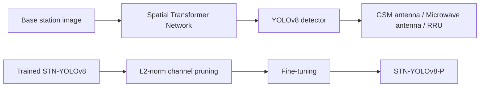

# STN-YOLOv8-P

**Multi-Object Detection of Mobile Communication Base Stations Based on STN-YOLOv8-P**

**Yang Tang** · IEEE ICPICS 2025

[](https://doi.org/10.1109/ICPICS66386.2025.11347168)


Research code and experiment artifacts for detecting **GSM antennas**, **microwave antennas**, and **remote radio units (RRUs)** in mobile communication base stations.

## Quick Links

- [Paper](https://doi.org/10.1109/ICPICS66386.2025.11347168)
- [Overview](#overview)
- [Repository Structure](#repository-structure)
- [Getting Started](#getting-started)
- [Project Workflow](#project-workflow)
- [Results](#results)
- [Reproducibility Notes](#reproducibility-notes)
- [Citation](#citation)

## Overview

STN-YOLOv8-P is a lightweight object detection framework designed for UAV-assisted inspection of mobile communication base stations. The method combines YOLOv8 with a Spatial Transformer Network (STN) and L2-norm structured channel pruning to address viewpoint variation and limited onboard computing resources.

On the antenna dataset, the paper reports **93.1% mAP50**, **68.9% mAP50-95**, and **4.1 GFLOPs**. Compared with YOLOv8n, this corresponds to gains of **0.4 percentage points in mAP50** and **1.0 percentage point in mAP50-95**. Computational cost is reduced by **50% relative to the unpruned STN-YOLOv8 model**.

### Method

1. **Spatial alignment:** an input STN learns differentiable affine transformations to compensate for changes in object position, scale, and orientation.
2. **Multi-object detection:** the YOLOv8 backbone, neck, and detection head extract and fuse features to localize and classify communication equipment.
3. **Model pruning:** convolutional output channels are ranked using their L2 norms; the paper describes a 10% pruning ratio per pruning step.
4. **Fine-tuning and evaluation:** the pruned model is fine-tuned to recover detection performance and compared with the unpruned models.



*The diagram summarizes the paper's method. See [Reproducibility Notes](#reproducibility-notes) for differences between the method and the current code snapshot.*

## Repository Structure

```text
.
├── ultralytics/                         # Local, modified Ultralytics source
│   ├── cfg/models/v8/                   # YOLOv8 and experimental STN configurations
│   ├── nn/modules/block.py              # SpatialTransformer implementation
│   ├── nn/tasks.py                      # Model construction and module imports
│   ├── engine/                          # Training, validation, and prediction engine
│   └── models/                          # Model interfaces
├── Utils/
│   └── Initailize_model.py              # Model initialization; original filename retained
├── antennasets/                         # Currently contains a saved YAML checkpoint only
├── antenna/fine_tuning/                 # Saved training experiment artifacts
├── runs/                               # Additional experiment outputs
├── pruningsave/                         # Saved pruning artifacts
├── demo.py                             # Training entry point
├── test.py                             # Validation example with a hard-coded path
├── predict.py                          # Prediction example with hard-coded paths
├── prune.py                            # L2-norm channel masking and fine-tuning
├── new_pre.py                          # Experimental layer-replacement pruning code
├── flops.py                            # THOP-based model profiling
├── prune_quant.ipynb                    # Pruning/quantization notebook
├── best.pt                             # Available checkpoint; provenance needs verification
├── yolov8n.pt                           # Checkpoint used by the default training entry
├── yolov8n_structured_pruned_weights.pt  # Pruning state dictionary saved by prune.py
├── yolov8n_structured_pruned_finetuned.pt # Fine-tuned state dictionary saved by prune.py
├── model.onnx                          # Existing ONNX artifact
└── README.md
```

The directory tree lists the main research files rather than every cached or experimental file. The presence of an artifact does not establish that it produced the paper's reported results.

## Getting Started

### 1. Environment

The paper reports the following experimental environment:

| Component | Configuration |
|---|---|
| Operating system | Ubuntu 22.04 |
| GPU | NVIDIA RTX 3090 |
| Python | 3.12 |
| PyTorch | 2.3.0 |
| CUDA | 12.1 |

Create an environment and install a compatible PyTorch/Torchvision build. The project includes a modified `ultralytics/` package whose version string is `8.0.120`; run examples from the repository root so Python resolves this local package.

```bash
conda create -n stn-yolov8-p python=3.12
conda activate stn-yolov8-p
```

The current snapshot does not include a root dependency manifest or a locked environment. The table above records the paper's environment, not a verified installation recipe. Install the dependencies required by the local source before running the examples; replacing it with an unrelated Ultralytics release may change model behavior or checkpoint compatibility.

After installing dependencies, check which package is imported:

```bash
python -c "import ultralytics; print(ultralytics.__file__); print(ultralytics.__version__)"
```

The printed path should point to this repository's `ultralytics/__init__.py`.

### 2. Dataset

The paper describes **1,317 original annotated images**, expanded to **5,135 images** after augmentation:

| Split | Images |
|---|---:|
| Training | 4,557 |
| Validation | 390 |
| Test | 188 |
| **Total** | **5,135** |

Preprocessing includes automatic orientation and resizing to **640 × 640**. Augmentations include flipping, rotation, shear, hue adjustment, and noise addition.

The current `antennasets/` directory does **not** contain the image/label splits or an active `data.yaml`. Supply the dataset in YOLO detection format:

```text
antennasets/
├── data.yaml
├── train/
│   ├── images/
│   └── labels/
├── valid/
│   ├── images/
│   └── labels/
└── test/
    ├── images/
    └── labels/
```

Each label line has the format `class_id x_center y_center width height`, with bounding-box coordinates normalized to the image dimensions. Preserve the following class order from the saved dataset configuration:

| Class ID | Class |
|---|---|
| 0 | GSM Antenna |
| 1 | Microwave Antenna |
| 2 | RRU |

Create `antennasets/data.yaml`, replacing the example absolute dataset path with your own:

```yaml
path: /absolute/path/to/antennasets
train: train/images
val: valid/images
test: test/images

nc: 3
names: ['GSM Antenna', 'Microwave Antenna', 'RRU']

# Additional fields read by demo.py
num_runs: 1
roboflow:
  project: antenna
```

For Windows paths, forward slashes can be used, for example `C:/datasets/antennasets`. The repository does not currently provide a verified public dataset download URL.

## Project Workflow

### 1. Model Training

After preparing the environment and dataset, the existing training entry can be invoked as follows:

```bash
python demo.py --yaml antennasets/data.yaml --model YOLOV8N --num_epochs 70 --train_batch_size 4 --resize_size 640 --folder ./antenna/
```

These settings match the default training script and an included experiment configuration; they are not a complete specification of the paper's final experiment. The script trains once per `num_runs` and writes outputs under:

```text
antenna/fine_tuning/antenna/YOLOV8N/Run_*/
```

**Model selection matters:** `YOLOV8N` loads `yolov8n.pt`. It does not automatically select the experimental STN YAML. The supplied `stnyolov8.yaml` places the STN in the head, whereas the paper describes input-level alignment. Confirm the intended architecture before using this entry for STN-YOLOv8 reproduction.

### 2. Validation

Use the Python API to specify paths explicitly, avoiding the original server paths in `test.py`:

```python
from ultralytics import YOLO

model = YOLO("best.pt")
metrics = model.val(data="antennasets/data.yaml", split="test", imgsz=640)

print(f"mAP50: {metrics.box.map50:.4f}")
print(f"mAP50-95: {metrics.box.map:.4f}")
```

Use `split="val"` for validation. Keep the validation and test sets distinct when reporting results. Check that the selected checkpoint corresponds to the intended architecture and experiment.

### 3. Image Prediction

```python
from ultralytics import YOLO

model = YOLO("best.pt")
results = model.predict(
    source="path/to/base_station.jpg",
    imgsz=640,
    conf=0.25,
    save=True,
    project="runs/detect",
    name="antenna_prediction",
)
```

Replace `source` with your image or image directory. The confidence threshold above is an example inference setting, not a claimed paper setting.

### 4. Pruning and Fine-Tuning

The existing `prune.py` loads `best.pt`, applies L2-norm output-channel masking to convolutional weights with `amount=0.1`, evaluates the result, and fine-tunes it using:

| Setting | Value in `prune.py` |
|---|---:|
| Pruning amount | 0.1 |
| Fine-tuning epochs | 13 |
| Image size | 640 |
| Batch size | 64 |
| Initial learning rate | 0.0001 |

Before running, replace every hard-coded `/root/autodl-tmp/STN-YOLO/antennasets/data.yaml` path in `prune.py` with your dataset YAML path. Use a working copy or distinct output filenames if you need to preserve the supplied pruning artifacts, because the script saves to their existing names.

```bash
python prune.py
```

The files saved by this script are **PyTorch state dictionaries**, not standalone Ultralytics checkpoints. Load them into the matching base architecture:

```python
import torch
from ultralytics import YOLO

model = YOLO("best.pt")
state = torch.load(
    "yolov8n_structured_pruned_finetuned.pt",
    map_location="cpu",
)
model.model.load_state_dict(state, strict=True)
metrics = model.val(data="antennasets/data.yaml", split="test", imgsz=640)
```

This assumes the base checkpoint matches the one used for pruning. Resolve mismatches rather than silently ignoring missing or unexpected keys.

### 5. Complexity Measurement

```bash
python flops.py
```

The profiling script evaluates a `1 × 3 × 640 × 640` input. It labels the value returned by `thop.profile` as GFLOPs; verify the profiler's MAC/FLOP convention before comparing its output with the paper. Also note that its first model summary is printed before loading the pruning state dictionary.

## Results

All values below are transcribed from **Tables I and II of the paper**, not newly measured from the supplied checkpoints. Percentage metrics are converted from the paper's decimal values.

### Model Comparison

| Model | Recall (%) | mAP50 (%) | mAP50-95 (%) | GFLOPs |
|---|---:|---:|---:|---:|
| YOLOv8n | 87.9 | 92.7 | 67.9 | 8.1 |
| STN-YOLOv8 | **89.7** | **93.5** | **70.4** | 8.2 |
| **STN-YOLOv8-P** | 88.2 | 93.1 | 68.9 | **4.1** |

Pruning reduces the reported computational cost from 8.2 to 4.1 GFLOPs, with decreases of 0.4 percentage points in mAP50 and 1.5 percentage points in mAP50-95 relative to STN-YOLOv8.

### Per-Class Detection Performance

| Class | Recall (%) | mAP50 (%) | mAP50-95 (%) |
|---|---:|---:|---:|
| GSM Antenna | 90.7 | 92.6 | 69.7 |
| Microwave Antenna | 89.4 | 95.5 | 72.9 |
| RRU | 84.4 | 91.3 | 64.2 |
| **All classes** | **88.2** | **93.1** | **68.9** |

Here, mAP50 uses an IoU threshold of 0.5; mAP50-95 averages over IoU thresholds from 0.5 to 0.95 in steps of 0.05. These are detection metrics, not classification accuracy.

## Reproducibility Notes

- **Architecture alignment:** the default initialization loads `yolov8n.pt`; the STN entry in `yolov8.yaml` is commented out, and `stnyolov8.yaml` is an experimental configuration that differs from the paper's input STN. A verified final model configuration is still needed for exact reproduction.
- **Pruning implementation:** `prune.py` applies channel masks and removes the pruning reparameterization, but does not shrink convolution tensor dimensions. This alone does not demonstrate the paper's reduction to 4.1 GFLOPs or a dense-inference speedup. Fine-tuning also runs after mask removal, so zeroed weights are not constrained to remain zero.
- **Experimental scripts:** `new_pre.py` attempts physical layer replacement, but channel consistency across connected layers is not verified. It is not presented here as a validated reproduction route.
- **Missing reproduction assets:** the image/label splits, active dataset YAML, dependency lockfile, and verified mapping from checkpoints to reported experiments are not included in the current snapshot.
- **Deployment status:** `model.onnx` is present, but the snapshot does not establish its relationship to the final paper model or provide verified onboard latency measurements.
- **Validation scope:** these instructions were checked against the supplied source and paper. Training, inference, and numerical reproduction were not executed as part of the README preparation.

## Citation

If you use this work, please cite:

```bibtex
@inproceedings{tang2025stnyolov8p,
  author    = {Yang Tang},
  title     = {Multi-Object Detection of Mobile Communication Base Stations Based on STN-YOLOv8-P},
  booktitle = {2025 IEEE 7th International Conference on Power, Intelligent Computing and Systems (ICPICS)},
  year      = {2025},
  pages     = {266--273},
  doi       = {10.1109/ICPICS66386.2025.11347168}
}
```

## Acknowledgements

This project builds on [Ultralytics YOLO](https://github.com/ultralytics/ultralytics) and the [STN-YOLO project](https://github.com/Advanced-Vision-and-Learning-Lab/STN-YOLO) by Yash Zambre, Ekdev Rajkitikul, Akshatha Mohan, and Joshua Peeples. Please retain the relevant upstream acknowledgements and cite their work when using the corresponding components.

## License

The bundled Ultralytics source includes AGPL-3.0 notices. No root-level project license file is included in this snapshot; this README does not assign a new license to the code, dataset, or model weights. Refer to the applicable upstream licenses and asset permissions when redistributing them.
